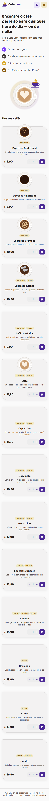
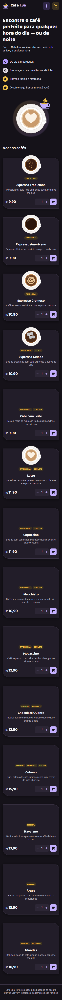
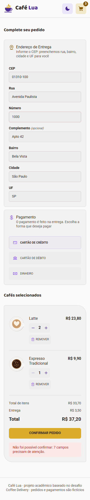
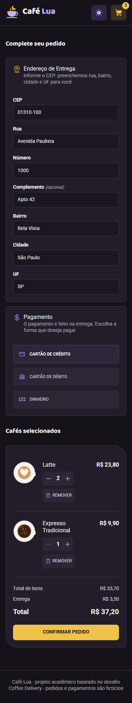
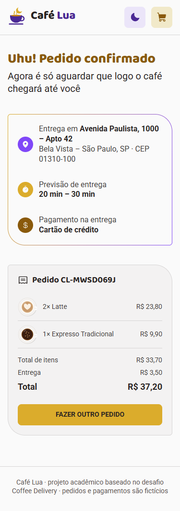
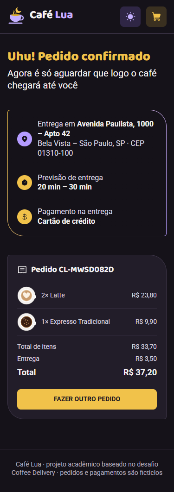
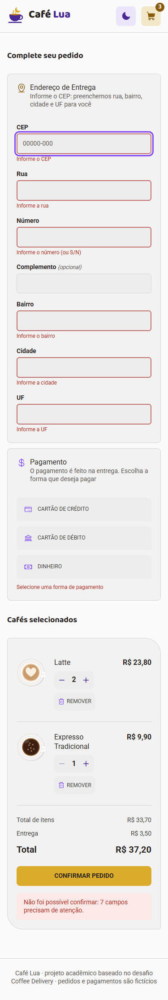

<p align="center">
  
</p>

<h1 align="center">Café Lua · Coffee Delivery</h1>

<p align="center">
  Projeto final da disciplina <strong>Single Page Application</strong> — React + TypeScript + IA.<br/>
  Catálogo de cafés, carrinho persistente, checkout com CEP automático e confirmação de pedido fictício.
</p>

<p align="center">
  <a href="https://coffee-delivery-gray-eight.vercel.app"><strong>🔗 Aplicação publicada na Vercel</strong></a> ·
  <a href="#">Figma — Coffee Delivery | Projeto Final React</a> (link fornecido pelo professor)
</p>

---

## Sumário
- [Objetivos](#objetivos) · [Funcionalidades](#funcionalidades) · [Screenshots](#screenshots)
- [Stack](#stack) · [Instalação e scripts](#instalação-e-scripts) · [Arquitetura](#arquitetura)
- [Decisões de produto](#decisões-de-produto) · [Branding com IA](#branding-com-ia)
- [Acessibilidade e responsividade](#acessibilidade-e-responsividade) · [Testes](#testes) · [Uso de IA](#uso-de-ia)

## Objetivos
Consolidar React, TypeScript, componentes, Props, Hooks, Context API + `useReducer`, imutabilidade, rotas, formulários com validação, persistência local, temas e testes — transformando o protótipo do Figma em uma SPA completa, inclusiva e documentada.

**Documentação SPEC:** [PRD](docs/PRD_SPEC.md) · [TECH](docs/TECH_SPEC.md) · [TASKS](docs/TASKS_SPEC.md) · [AGENTS](AGENTS.md) · [AI_USAGE](docs/AI_USAGE.md)

## Funcionalidades
- ☕ Catálogo de 14 cafés com imagem, tags, descrição e preço (RF-01)
- ➕ Quantidade antes de adicionar; produto repetido acumula sem duplicar (RF-02, RF-03)
- 🛒 Badge no Header com a **soma das unidades** (RF-04)
- ✏️ Aumentar, diminuir e remover no checkout com totais imediatos (RF-05)
- 💾 Carrinho, tema e último pedido persistidos em `localStorage` (RF-06, RF-14)
- 📮 CEP consultado no **ViaCEP** preenche rua, bairro, cidade e UF; erros para CEP inválido, não encontrado e API fora do ar (RF-08)
- 💳 Pagamento obrigatório (crédito, débito ou dinheiro) — apenas informativo (RF-09)
- 🧾 Subtotal + entrega fixa de R$ 3,50 = total, calculados em centavos (RF-10)
- ⛔ Confirmação bloqueada com carrinho vazio ou formulário inválido, com erro anunciado (RF-11)
- ✅ Tela de sucesso a partir de um *snapshot* do pedido; carrinho é limpo (RF-12, RF-13)
- 🌙 Light/dark mode com fallback para `prefers-color-scheme` (RF-14)
- 📱 Mobile first, testado de 320 a 1440 px (RF-15)
- 🎨 Logo original criada com IA no Header e no favicon (RF-16)

## Screenshots

| | Mobile claro | Mobile escuro |
| --- | --- | --- |
| **Home** |  |  |
| **Checkout** |  |  |
| **Sucesso** |  |  |
| **Erros de validação** |  | |

**Desktop:** [Home claro](docs/screenshots/home-desktop-light.png) · [Home escuro](docs/screenshots/home-desktop-dark.png) · [Checkout claro](docs/screenshots/checkout-desktop-light.png) · [Checkout escuro](docs/screenshots/checkout-desktop-dark.png) · [Sucesso claro](docs/screenshots/success-desktop-light.png) · [Sucesso escuro](docs/screenshots/success-desktop-dark.png)

> As imagens são geradas automaticamente por `npm run screenshots`, que percorre o fluxo inteiro num navegador real.

## Stack
React 19 · Vite 8 · TypeScript (estrito, sem `any`) · React Router 7 · Context API + `useReducer` · React Hook Form + Zod · styled-components · Phosphor Icons · Vitest + Testing Library · Playwright (script de evidências) · ViaCEP. Justificativas no [TECH_SPEC](docs/TECH_SPEC.md#1-stack-e-justificativa).

## Instalação e scripts

Requisitos: Node.js 20+ e npm.

```bash
git clone <url-do-repositório>
cd coffee-delivery
npm install
npm run dev
```

| Script | O que faz |
| --- | --- |
| `npm run dev` | Servidor de desenvolvimento em http://localhost:5173 |
| `npm test` | Testes automatizados (Vitest) |
| `npm run lint` | Lint (oxlint) |
| `npm run build` | Type-check + build de produção em `dist/` |
| `npm run preview` | Serve o build de produção |
| `npm run screenshots` | Com o `dev` rodando: fluxo completo no Edge (ou `BROWSER=chrome`), screenshots e checagem de rolagem horizontal em 320–1440 px |
| `npm run generate:assets` | Regenera logo, favicon e ilustrações SVG |

**Deploy (Vercel/Netlify):** build `npm run build`, pasta `dist`. Para as rotas da SPA funcionarem ao recarregar, configure *rewrite* de `/*` para `/index.html` (o [`vercel.json`](vercel.json) e o [`public/_redirects`](public/_redirects) já fazem isso).

## Arquitetura

```
main.tsx → BrowserRouter → AppThemeProvider → CartProvider → App (rotas)
                                                     │
      useCart() ◀── CartContext ◀── useReducer(cartReducer) + localStorage
```

| Pasta | Responsabilidade |
| --- | --- |
| `src/components` | UI reutilizável (Header, CoffeeCard, QuantityInput, CartItem, CartSummary, DeliveryAddressForm, PaymentMethodSelector…) |
| `src/pages` | Home, Checkout, Success |
| `src/contexts` | CartProvider (carrinho + último pedido) e AppThemeProvider |
| `src/reducers/cart` | Ações e reducer puro/imutável |
| `src/hooks` | `useCart`, `useTheme`, `useLocalStorage`, `useCepLookup` |
| `src/schemas` | Schema Zod do checkout |
| `src/services` | Cliente do ViaCEP |
| `src/utils` | Cálculos em centavos, formatação BRL, CEP, *type guards* |
| `src/styles` | Tokens dos temas claro/escuro e estilos globais |
| `src/tests` | Testes de unidade e de integração |

## Decisões de produto
| Decisão | Motivo |
| --- | --- |
| Valores em **centavos** | `3 × 9.90` em ponto flutuante dá `29.700000000000003` |
| `−` desabilitado em 1 no carrinho; remover é um botão explícito | Evita remoção acidental no toque (RN-01) |
| Frete fixo de R$ 3,50 (R$ 0 com carrinho vazio) | Valor do protótipo, centralizado em `DELIVERY_FEE_IN_CENTS` |
| Carrinho guarda só `coffeeId` + `quantity` | Preço sempre vem do catálogo; itens removidos do catálogo somem (RN-10) |
| Pedido confirmado é um *snapshot* | `/success` continua correto após limpar o carrinho e após F5 (RN-06) |
| Rotas de Checkout/Sucesso com `React.lazy` | Bundle inicial de 110 kB gzip |

## Branding com IA

<p>
  
  
</p>

| Item | Descrição |
| --- | --- |
| **Ferramenta** | Claude (Opus 5.5, Anthropic) via Claude Code, gerando o desenho como **código SVG vetorial** (`scripts/generate-brand.mjs`) |
| **Prompt** | *"Crie uma marca original para uma cafeteria delivery que funcione em tema claro e escuro, mantendo o amarelo/roxo e as fontes Baloo 2/Roboto do Style Guide do Figma. Quero nome, conceito, símbolo simples legível em 16 px, versão para fundo claro, versão para fundo escuro e favicon."* |
| **Resultado** | Nome **Café Lua** — "do café da manhã ao café da madrugada". Símbolo: xícara roxa cujo vapor sobe até uma **lua crescente** amarela. |
| **Variações** | `logo-symbol-light.svg` / `logo-symbol-dark.svg` (Header troca conforme o tema), `logo-horizontal-*.svg` (documentação) e `public/favicon.svg` (símbolo sobre quadrado roxo, legível em abas claras e escuras). |
| **Paleta** | Amarelo `#DBAC2C` / `#F1C24A` (café, lua) · Roxo `#4B2995` / `#C4B0FF` (céu noturno) · Neutros do Style Guide. |
| **Tipografia** | Baloo 2 (títulos e logotipo) e Roboto (textos). |
| **Por que esta proposta** | O conceito *dia/noite* dá sentido ao requisito de light/dark mode; reaproveita as cores do protótipo com significado; formas simples continuam legíveis em 16 px. |
| **Legibilidade** | Verificada no favicon (16 px), no Header mobile (40 px) e nos dois temas. |
| **Direitos de uso** | Desenho vetorial original gerado a partir de formas geométricas simples em código; não reutiliza a marca do protótipo nem imagens de terceiros. Os termos de uso da Anthropic atribuem a quem fez o pedido os direitos (se houver) sobre o resultado gerado — confira a versão vigente antes da entrega. |

> 💡 Se o professor exigir especificamente uma ferramenta de **geração de imagem** (ex.: DALL·E, Midjourney, Firefly), gere uma proposta raster com o mesmo prompt, compare com esta e registre a escolha aqui.

## Acessibilidade e responsividade
- Referência WCAG 2.2 AA: contraste revisado nos dois temas, `:focus-visible` de 3 px, link "Pular para o conteúdo".
- Todos os campos têm `<label>`; erros usam `aria-invalid` + `aria-describedby`; resumo de erro com `role="alert"`; foco vai para o primeiro campo inválido.
- Pagamento com radios nativos em `fieldset` (setas do teclado funcionam); badge e consulta de CEP com `aria-live`.
- Alvos de toque ≥ 34×40 px; `prefers-reduced-motion` respeitado.
- Grid do catálogo: 1 → 2 → 3 → 4 colunas; checkout em coluna única até 1024 px. Sem rolagem horizontal em 320, 375, 390, 768, 1280 e 1440 px (verificado por `npm run screenshots`).

## Testes
`npm test` → **47 testes** em 7 arquivos:

| Arquivo | Cobertura |
| --- | --- |
| `cart.reducer.test.ts` | adicionar, acumular, limites 1–99, incrementar, decrementar, remover, limpar, **imutabilidade** |
| `utils.test.ts` | centavos, BRL, soma de unidades, frete, CEP, *guards* |
| `checkout.schema.test.ts` | campos obrigatórios, CEP, UF, pagamento, complemento opcional |
| `viaCep.test.ts` | sucesso, CEP incompleto, não encontrado, HTTP 400/503, falha de rede, cancelamento |
| `useLocalStorage.test.ts` | leitura, JSON corrompido, formato inválido, gravação |
| `theme.test.tsx` | alternância, persistência, `prefers-color-scheme` |
| `flow.test.tsx` | Home → carrinho → refresh → checkout com CEP → sucesso → refresh |

## Uso de IA
O desenvolvimento foi apoiado por um assistente de IA seguindo as regras do [`AGENTS.md`](AGENTS.md). As interações relevantes (prompt, objetivo, resposta, decisão e evidência) estão em [`docs/AI_USAGE.md`](docs/AI_USAGE.md).

---
Projeto acadêmico baseado no desafio *Coffee Delivery*. Pedidos e pagamentos são fictícios.
